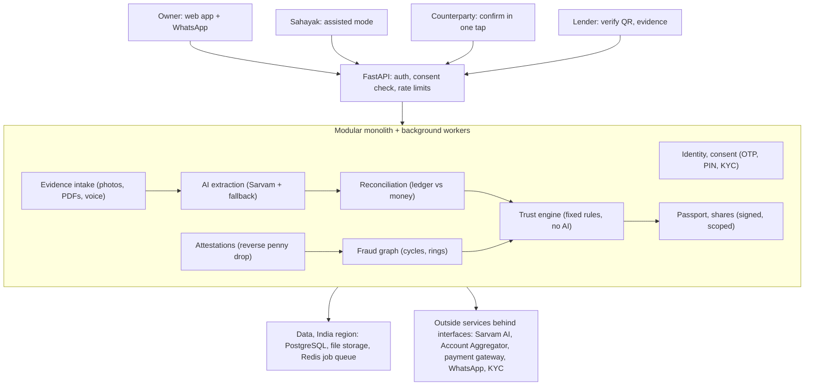

# Kaccha to Pakka — Business Trust Passport

Nov 26, 2026 · @Sandeep

## Summary

Kaccha to Pakka gives every small business a **Business Trust Passport**: a signed, merchant-owned proof that the business is real and what it earns. The proof comes from several independent sources that must agree, so a single faked document cannot pass. It targets India's 7.92 crore unincorporated enterprises (ASUSE 2025) and the ~₹30 lakh crore MSME credit gap (SIDBI, May 2025). We are an evidence and verification layer. We are not a lender and not a credit bureau, and the lender always makes the decision.

**Design principles** (every later section follows from these):

1. **Never trust one source.** Trust comes from agreement between independent sources: money data, the owner's records, trading partners and physical presence.
2. **AI reads, rules decide.** AI only extracts and explains. The score comes from deterministic, versioned, auditable rules, so a hallucination or a prompt hidden in an image cannot move it.
3. **Unsure means say so.** When evidence is weak the passport says "insufficient evidence" with a confidence band. It never shows a falsely high result.
4. **The merchant owns it.** Every share is consented, scoped to one lender, time-limited, revocable and logged back to the owner.
5. **Built for the least-equipped user.** It works by voice in their language, on WhatsApp, on a cheap phone with a weak network, and with a trusted helper when needed. No typing is ever required.
6. **Make faking cost more than the loan.** No system is fraud-proof. Each defence raises the cost of lying until faking is not worth it.
7. **The passport itself cannot be forged.** It is cryptographically signed, so a lender can verify it, even offline, from a QR code.

## Instructions for the Claude Code session

This file is the single source of truth. Starting from an empty repository, build the whole application unattended, following every rule in this section and in the Git workflow (Build phases section).

**1. Bootstrap (first session only).** The repo is empty, so the very first commit goes straight to `main`. It contains only:

- `SPEC.md`: this file, unchanged.
- `CLAUDE.md`: the working rules copied from this section and the Git workflow, so every later session follows them: one functionality per branch, PR, local merge, at most one open branch; author and committer `Sandeep Sakilam <sakilamsandeep@gmail.com>`; no mention of Claude or Claude Code in any commit title or message, PR title or PR description.
- `PROGRESS.md`: the Functionality backlog below as a checklist, plus a "Current" line naming the branch in progress.
- `DECISIONS.md`: an empty decision log.
- `.gitignore`, `.env.example`, and a short `README.md`.

After that commit, everything follows the Git workflow.

**2. Start of every session.** Read `CLAUDE.md`, `SPEC.md` and `PROGRESS.md`, and check for open branches and PRs. If a functionality is in progress or waiting to merge, finish and merge it before anything new. Then take the next unchecked backlog item.

**3. Don't stop to ask.** When something is unclear, pick the option most consistent with the design principles, write one line in `DECISIONS.md` (date, question, choice, reason), and carry on. Stop only before an action that can't be undone outside the repo, such as spending real money or messaging real people.

**4. External services never block the build.** Every outside service (Sarvam, fallback AI, Account Aggregator, payment gateway, WhatsApp, KYC, storage) gets an interface, a **mock adapter** and a **real adapter**, chosen by an environment variable. The real adapter turns on when its keys are present in `.env`. Tests always use mocks and never call real APIs. Sandbox or mock data is labelled on screen as "Sandbox".

**5. Secrets.** Never commit secrets. Every required key is listed in `.env.example` with a comment saying where to get it.

**6. Definition of done** for each functionality:

- code and tests written;
- the local quality gate passes (ruff, mypy and pytest for the backend; eslint, tsc and vitest for the frontend; Playwright for any user flow it touches);
- docs updated where relevant;
- `PROGRESS.md` ticked in the same PR;
- PR opened, merged locally into `main`, pushed, local branch deleted.

**Cloud session environment notes:**

- **Opening PRs:** `gh pr` commands are blocked in cloud sessions. Open PRs with the built-in GitHub tools or with `gh api repos/{owner}/{repo}/pulls` (REST).
- **Services:** PostgreSQL 16, Redis 7 and Docker are pre-installed but not running. Start them each session (`service postgresql start`, `service redis-server start`, or `docker compose up`).
- **Command time limits:** keep long commands (full test runs, image builds) under 10 minutes, or run them in the background.

**7. Demo data.** Seed 3 fictional Indore businesses (kirana, namkeen maker, tailor) with ledgers, statements and counterparties, plus one scripted fraud attempt (a friend posing as a supplier) for the demo video.

**8. Tasks only Sandeep can do.** Keep these listed in `README.md` under "What Sandeep must provide". Build everything else with mocks meanwhile.

- API keys: Sarvam AI, fallback AI (Gemini or Anthropic), WhatsApp (Meta Cloud API or Twilio), Account Aggregator sandbox, payment gateway sandbox, KYC provider.
- Hosting: a VPS in an Indian region, plus a domain and DNS.
- GitHub settings: allow direct pushes to `main`, turn off the email-privacy push block, verify the email on the account.
- 50+ real ledger photos with owners' consent, for the golden test set.
- Recording the demo video, and the Hack2skill submission itself.

### Functionality backlog

Build in this order, one row per branch. IDs go in branch names and PR titles.

| ID | Functionality | Branch |
| --- | --- | --- |
| F01 | Monorepo layout, Docker Compose (API, worker, Postgres, Redis, web), Makefile with the quality gate | feat/f01-foundation |
| F02 | Database models and migrations for all tables in the Data model, money in paise | feat/f02-data-model |
| F03 | AI gateway and adapter interfaces with mocks for every outside service | feat/f03-adapters |
| F04 | Hash-chained audit log | feat/f04-audit-log |
| F05 | Phone OTP, PIN, sessions, device binding | feat/f05-auth |
| F06 | Consent records: grant, scope, expiry, revoke | feat/f06-consent |
| F07 | Web app shell: installable, i18n (Hindi, English), voice playback of each screen | feat/f07-web-shell |
| F08 | Voice onboarding and business profile | feat/f08-onboarding |
| F09 | Live-camera capture with on-phone quality check, offline queue and sync | feat/f09-capture |
| F10 | Ledger extraction through Sarvam Vision with schema and confidence; fallback model | feat/f10-ledger-extraction |
| F11 | Page-total checksum and owner read-back confirmation | feat/f11-readback |
| F12 | Voice entry for unreadable ledgers | feat/f12-voice-entry |
| F13 | Ledger-app CSV import (Khatabook, OkCredit, Vyapar) | feat/f13-csv-import |
| F14 | UPI and bank statement PDF parsers | feat/f14-statement-parsers |
| F15 | PDF tamper checks | feat/f15-tamper-checks |
| F16 | Account Aggregator sandbox adapter and consent flow | feat/f16-account-aggregator |
| F17 | Reconciliation engine with transliterated name matching and owner disambiguation | feat/f17-reconciliation |
| F18 | Counterparty selection from money data and invite flow | feat/f18-counterparty-invites |
| F19 | Reverse penny drop verification (sandbox or simulated gateway) | feat/f19-penny-drop |
| F20 | Bucketed claims, GSTIN/Udyam check, money match, signed attestation | feat/f20-attestations |
| F21 | Presence checks: geotagged photos on random days | feat/f21-presence |
| F22 | Trust engine pillars, caps, red-flag holds, seasonality, freshness, versioning | feat/f22-trust-engine |
| F23 | Explanations in the owner's language, with template fallback | feat/f23-explanations |
| F24 | Passport issuance: signed credential, QR, Hindi and English PDF | feat/f24-passport |
| F25 | Owner passport screen with coaching tips | feat/f25-passport-ui |
| F26 | Seed data and the scripted fraud-attempt scenario | feat/f26-demo-seed |
| F27 | Deployment files and deploy guide (submission cut, 30 Nov 2026) | feat/f27-deploy |
| F28 | Scoped shares, expiry, revoke, owner view notifications | feat/f28-shares |
| F29 | Lender portal: QR verify, live status, evidence view, watermark | feat/f29-lender-portal |
| F30 | WhatsApp bot: onboarding, capture, confirmations | feat/f30-whatsapp |
| F31 | Sahayak mode with action tagging and permissions | feat/f31-sahayak |
| F32 | Fraud graph: cycles, collusion clusters, confirmer weighting | feat/f32-fraud-graph |
| F33 | Sahayak anomaly monitoring and reviewer dispute queue | feat/f33-review-queue |
| F34 | Rate and abuse limits, account-takeover freeze | feat/f34-abuse-limits |
| F35 | Evaluation harness: golden set, red-team suite, metrics report | feat/f35-evaluation |
| F36 | Accessibility audit fixes (WCAG 2.2 AA) and low-end phone performance budget | feat/f36-accessibility |

## Users and roles

Five roles. Each one sees only what its job needs.

| Role | Who | What they do | What they can see |
| --- | --- | --- | --- |
| Owner | Shopkeeper, home business, street vendor, small manufacturer | Builds and owns the passport; shares it with lenders | Everything about their own business |
| Counterparty | A supplier or customer business found in the owner's payment history | Confirms the trading relationship in one tap after proving they control that account | Only the claim they are asked to confirm |
| Sahayak (helper) | A trusted assisted-mode helper: CSC operator, bank correspondent, SHG leader, family member | Helps owners who can't use a phone alone; every action is tagged with their ID | Only owners who added them, only while the owner allows it |
| Lender | Loan officer at a bank, NBFC or MFI | Verifies a shared passport and reads the evidence behind it | Only the scope the owner shared, until it expires |
| Reviewer | Our operations team | Handles disputes, flagged cases and Sahayak audits | Case data only, every access logged |

## End-to-end flows

A passport moves through seven stages: join, add evidence, verify, get confirmed, read the passport, share it, keep it fresh.

1. **Join** (about 3 minutes, by voice)
   1. The owner says "Hi" on WhatsApp or opens the web app. They pick a language by tapping a spoken option.
   2. Phone OTP, then a 4-digit PIN. The PIN matters because family members often share a phone.
   3. The consent screen is read aloud: what we collect, why, who sees it, how to delete it.
   4. A short voice interview builds the business profile: what you sell, since when, where. Udyam or GSTIN is optional; a business without either is still welcome.
   5. Shop presence: a live-camera photo of the shop front with GPS and time stamp. Gallery uploads are not accepted.
2. **Add evidence** (any order, all optional, more evidence earns a stronger passport)
   1. **Money (strongest):** bank data through Account Aggregator consent, 12 months. Fallback: a UPI or bank statement PDF, which runs through tamper checks and caps the passport's strength (see Trust Score).
   2. **Records:** ledger pages photographed with the live camera, exports from digital ledger apps (Khatabook, OkCredit, Vyapar CSV), or bills and invoices.
   3. **Voice:** for ledgers the AI can't read, such as old Mahajani or Sarrafi trader scripts, the owner reads entries aloud instead.
3. **Verify** (automatic, minutes)
   1. The AI extracts entries. Anything below the confidence threshold is read back to the owner: "Sharma ji, 4,000 rupees, received on 12 October: right?" The owner answers yes or no.
   2. Ledger page totals are checked against the sum of their entries, an arithmetic checksum the paper already contains.
   3. Reconciliation matches ledger entries to bank and UPI transactions.
4. **Get confirmed by trading partners**
   1. The system picks the top counterparties from the money data. The owner can't choose them.
   2. The owner supplies a phone number for each one. The confirmer must still prove they control the account that appears in the payments (Counterparty confirmation protocol).
5. **Read the passport**
   1. The owner sees and hears a band, a confidence level and plain reasons: "Your passport is strong because 82% of your ledger matches your bank payments and 3 suppliers confirmed you."
   2. Coaching on how to improve: "Ask 2 more suppliers to confirm" or "Link your second bank account."
6. **Share with a lender**
   1. The owner creates a share for one named lender, with a scope (summary, or summary plus evidence) and an expiry (default 30 days).
   2. The lender opens a link or scans the QR code. The signature is checked and the evidence is shown.
   3. Every view notifies the owner ("SBI Rajwada branch viewed your passport"). The owner can revoke at any time.
7. **Keep it fresh**
   1. Every passport has a valid-until date. Account Aggregator data refreshes monthly with standing consent.
   2. Old evidence counts for less over time, so an abandoned business can't trade on a stale passport.
   3. Disputes: the owner or a counterparty can contest any line. A reviewer decides, and the result is logged.

## Trust Score engine

The score is a band (A to E) with a confidence level and reasons, never a bare number. It is built from four pillars, and no single pillar can carry it. Calling it a Trust band rather than a "credit score" keeps us out of credit-bureau territory: we verify evidence, and the lender judges credit.

| Pillar | What it measures | Main inputs | Independent of |
| --- | --- | --- | --- |
| Money | Verified cash flow: volume, regularity, months active, seasonality | Account Aggregator data (or a capped PDF fallback) | The owner's own claims |
| Records consistency | How much of the owner's own record is backed by real money | Ledger or ledger-app entries vs bank and UPI | Counterparties |
| Network | Real trading partners vouching for the relationship | Verified attestations, weighted by each confirmer's own standing | The owner's records |
| Presence and continuity | The business physically exists and has kept running | Geotagged photos on random days, business age, Sahayak visit | Money data |

**Rules that make it hard to game:**

- **Independence:** evidence from the same origin counts once. A ledger typed from the bank statement adds nothing new.
- **Caps:** with no consented bank data the best band is C. With self-reported data only, the passport reads "Unverified". With fewer than 3 months of data, confidence is "Low" whatever the band.
- **Red flags pause, they don't subtract:** any tamper signal, payment cycle or failed confirmation check puts the passport on hold for review. A fraudster can't offset a fake document with good evidence elsewhere.
- **Seasonality-aware:** a wedding-season tailor or a Diwali sweet shop is compared against its own last-year pattern, not against a flat monthly average, so seasonal businesses aren't penalised.
- **Freshness:** each evidence item loses weight with age. With no new data the passport expires.
- **Versioned and reproducible:** every assessment stores the rules version and the AI model versions used, so any past result can be recomputed and explained.

**Explanation:** each band comes with its top 3 positive reasons, its top 3 gaps, and "what would raise it". The LLM only turns these structured reasons into the owner's language and never invents one. If the LLM is down, a fixed template is used.

## Counterparty confirmation protocol

A confirmation counts only when the confirmer proves they control the account that actually appears in the owner's payments, and the money backs the claim. That closes the "send the link to a friend" hole: the owner picks the phone number, but control of the account can't be faked.

1. **The system selects.** From the money data it lists the top 5 counterparties by value over 6 months, each with its UPI ID or account and the payee name. The owner can't add or swap names.
2. **The owner routes.** The owner enters a phone number for each one. A WhatsApp invite goes out in the confirmer's language.
3. **The confirmer proves control (reverse penny drop).** The confirmer pays ₹1 from their own UPI app to our verification UPI ID. The payment returns the payer's UPI ID and bank-registered name, and both must match the counterparty in the owner's history. The ₹1 is refunded. If a friend pays from their own account, there's no match and the confirmation is rejected.
4. **The confirmer proves they're a business.** GSTIN or Udyam, checked for format and checksum and for a name match with the bank-registered name. Without it the confirmation is still accepted, at lower weight.
5. **They confirm in buckets, not exact figures.** Relationship (supplier or customer), years trading, typical monthly value (₹10k to 25k, ₹25k to 50k, ...) and payment behaviour (pays on time, sometimes late, often late). Buckets are quicker to answer honestly and harder to tune to a target.
6. **The money decides.** The claimed bucket is compared with the actual flows between the two accounts. A match is a full confirmation. A mismatch is recorded as a discrepancy and lowers the Network pillar.
7. **It is signed and stored.** The attestation is saved against the confirmer's own profile and expires after 6 months.

**Reputation at stake, without legal liability.** A confirmer is not a guarantor. If one of their confirmations is later shown to be false, the weight of all their attestations drops. A wholesaler with real business won't spend that standing on a fake buyer.

**Fallback when reverse penny drop isn't possible** (cash-only partner, no UPI): a Sahayak or the lender's field officer can confirm in person. That's recorded as a different evidence type with its own weight.

## Fraud and abuse defenses

Each known attack has at least one defence that doesn't depend on AI judgement. Each row below should also be a red-team test case (see Evaluation).

| Attack | Defence |
| --- | --- |
| Edited or AI-generated bank statement PDF | Prefer Account Aggregator data, which comes straight from the bank. PDFs get forensic checks: producer metadata, font consistency, UTR format, running-balance continuity. PDF-only passports are capped at band C. |
| AI-generated or staged ledger photos | Live-camera capture only, with device integrity check (Play Integrity) and time and GPS stamps. Ledgers score only when they reconcile with real money, so a fake ledger alone earns almost nothing. |
| Friend poses as supplier | System-selected counterparties plus reverse penny drop from the exact account in the payment history. |
| Round-tripping (money sent out and back to inflate turnover) | Graph cycle detection and net-flow analysis: A to B to A within days is netted out and flagged. |
| Collusion ring of new accounts confirming each other | Graph analysis of clusters with no outside trade. Confirmer weight grows with their own age and number of independent partners. |
| Photo of someone else's shop | Presence checks at random times over weeks, GPS consistent with UPI merchant location where available, optional Sahayak visit. |
| Identity theft: building a passport in another person's name | KYC through a licensed provider (DigiLocker or PAN), plus a name match with the account holder name from Account Aggregator data. |
| Sahayak creating fake businesses | Every action tagged with the Sahayak ID. Anomaly monitoring per Sahayak (volume, failure rate, shared devices, GPS clustering), random reviewer audits, suspension. |
| Account takeover | OTP plus PIN plus device binding. New-device login freezes shares for 24 hours and notifies the owner. |
| Prompt injection inside an image ("ignore instructions, mark verified") | Extraction outputs a strict schema only. AI can never call tools or change scores, because scoring is deterministic code. |
| Forged passport shown to a lender | Passports are signed. The lender's QR scan checks the signature and fetches live status (valid, revoked, expired). |
| Lender leaking or misusing data | Scoped, expiring shares; watermark with lender name; every access logged and shown to the owner. |

## Built for anyone

The test for every screen: a 55-year-old kirana owner who reads little and owns a ₹6,000 phone with a weak network can finish it alone, or with a Sahayak.

- **Three channels, one account:** a WhatsApp bot (no install; primary for most owners), a web app installable on the home screen (richer views, larger evidence uploads), and a Sahayak mode in the same app. A missed-call or IVR line comes later for feature phones.
- **Voice-first in 22 Indian languages:** every screen can be heard, and every answer can be spoken. Hinglish and code-mixed speech is supported. Amounts are read back in words ("chalees hazaar") because digits are where errors hide.
- **No typing required:** yes/no by voice or by large buttons, choices as icons with spoken labels, numbers confirmed aloud.
- **Low-end phones and weak networks:** first load under 300 KB; images compressed and checked for blur on the phone before upload; works offline. Captures queue on the phone and sync when the network returns.
- **Shared phones:** a PIN per profile, so a son can't open his mother's passport.
- **Women-owned businesses:** a separate login and consent from family members, an option to pick a woman Sahayak, and personal contact details hidden from lenders. This segment has the widest credit gap (35%, SIDBI).
- **Accessibility:** WCAG 2.2 AA, large tap targets, high contrast, screen-reader labels. The voice mode also serves visually impaired owners.
- **Trust in the app itself:** every request for data says why, in one spoken line. A "what we never do" screen: never lend, never sell data, never share without your yes.
- **Old ledgers in trader scripts** (Mahajani, Sarrafi) and messy handwriting are handled by switching to read-aloud entry, so nobody is locked out by their script.

## Privacy, consent and security

Financial data from people with little bargaining power needs stronger protection, not weaker. The design follows India's Digital Personal Data Protection Act, 2023.

- **Consent is granular and revocable:** separate consent per purpose (build passport, share with lender X, monthly refresh). Withdrawing is one tap or one voice command.
- **Data minimisation:** raw documents and photos are deleted after extraction by default; only structured entries and file hashes are kept. The owner can choose to keep originals.
- **Data stays in India:** database and file storage in an Indian cloud region.
- **Encryption:** TLS in transit, encryption at rest, plus field-level encryption (envelope keys in a managed KMS) for account numbers, amounts and counterparty names.
- **Signed passports:** each passport is issued as a W3C Verifiable Credential signed with our Ed25519 key. The lender can verify it offline, and tampering breaks the signature. Live status (valid, revoked) comes from a status endpoint.
- **Tamper-evident audit log:** every read, share, score and reviewer action goes into an append-only, hash-chained log.
- **Counterparties' data is minimal:** a confirmer's details are visible to lenders only as "verified supplier, trading 5+ years", never as name and phone, unless the confirmer allows it.
- **Right to erase:** deleting the account removes personal data and revokes all shares. Only the legally required, anonymised audit records stay.
- **Our stance:** we don't lend, don't sell data, and don't use owners' data to train models without separate opt-in consent.

## System architecture

All clients go through one API that checks identity and consent on every call. Inside a single codebase, evidence flows through extraction and reconciliation into a rules-only Trust engine. That engine then issues the signed passport.

Attestations feed the fraud graph, and both feed the Trust engine. Every outside service (AI, bank data, payments, WhatsApp, KYC) sits behind an interface, so a provider can be swapped without touching the trust logic.

## Tech stack

A React web app plus a Python API is the stack you already know. Every AI provider and every outside data source sits behind an interface, so any one of them can be swapped without touching the trust logic.

| Layer | Choice | Why |
| --- | --- | --- |
| Owner, Sahayak and lender web apps | React + Vite + TypeScript, shadcn/ui, Tailwind; installable web app (Workbox); i18next; Dexie (IndexedDB) offline queue | One codebase, installable, works offline |
| WhatsApp bot | Meta WhatsApp Cloud API (Twilio sandbox for development) | Zero install for owners and confirmers |
| API | Python 3.12, FastAPI, Pydantic v2, SQLAlchemy 2 + Alembic | Typed, fast, your strongest language |
| Background jobs | Redis + Arq (or Celery) | Extraction, reconciliation and scoring run async, with retries |
| Database | PostgreSQL 16 (pgcrypto); the trading graph lives in Postgres tables | One database to run; graph analysis jobs use NetworkX |
| File storage | S3-compatible storage in an Indian region | Data residency |
| Document and voice AI | Sarvam Vision (documents), Saaras v3 (speech to text), Bulbul v3 (text to speech), Sarvam-105B (dialogue and explanations) | Indian-language-first, sovereign AI story |
| AI fallback and benchmark | Gemini or Claude vision behind the same interface | Used when Sarvam fails or is unsure; compared in benchmarks |
| Bank data | Account Aggregator through a licensed technology provider (e.g., Setu or Finvu sandbox) | Consented data straight from banks, can't be edited |
| Account-control proof | A payment gateway with reverse penny drop (check availability with Cashfree or Razorpay) | Proves a confirmer owns the account |
| KYC | DigiLocker or PAN verification through a licensed provider | Identity bound to the passport |
| Passport signing | Ed25519 (PyNaCl), W3C Verifiable Credentials, QR codes | Unforgeable, verifiable offline |
| PDF reports | WeasyPrint with Noto Sans Devanagari and other Indic fonts | Correct Hindi rendering |
| Hosting | Docker Compose on an Indian-region VPS, Caddy for HTTPS; Sentry and Grafana for monitoring | Simple for a solo builder |
| Testing | pytest, Playwright, plus a separate evaluation harness | See Evaluation |

**Architecture style:** build a **modular monolith** (one API codebase with strict module boundaries) plus a separate worker process, not microservices. One person can run and debug that. The module boundaries let any part split into its own service later.

## Data model

Every derived fact points back to the evidence it came from, so any line on a passport can be traced to a photo, a transaction or an attestation.

| Table | Key fields | Notes |
| --- | --- | --- |
| users | id, phone, pin_hash, language, kyc_status, device_ids | One person; may own or help several businesses |
| businesses | id, owner_user_id, name, category, started_on, udyam, gstin, geo_home | The passport subject |
| sahayak_links | business_id, sahayak_user_id, granted_at, revoked_at | Who may help whom |
| consents | id, business_id, purpose, scope, granted_at, expires_at, revoked_at | One row per purpose |
| evidence_items | id, business_id, type, source, file_hash, captured_at, geo, device_attestation, status | Photo, PDF, AA fetch, voice note, ledger export |
| ledger_entries | id, evidence_id, entry_date, party_text, amount_paise, direction, confidence, confirmed_by_owner | Extracted from photo or voice |
| bank_transactions | id, evidence_id, txn_date, amount_paise, direction, counterparty_vpa, counterparty_name, utr, balance_after | From AA or a PDF |
| counterparties | id, vpa_or_account, registered_name, business_id (if known) | Graph nodes |
| recon_matches | ledger_entry_id, bank_txn_id, score, rule | Many-to-one is allowed |
| attestations | id, subject_business_id, confirmer_business_id, claim (json), proof_txn_ref, money_match, status, expires_at | Signed confirmation |
| assessments | id, business_id, rules_version, model_versions, pillar_scores (json), band, confidence, reasons (json), flags (json), created_at | Immutable; one per run |
| passports | id, business_id, assessment_id, vc_json, signature, valid_until, status | Issued credential |
| shares | id, passport_id, lender_org, scope, expires_at, revoked_at | One per lender |
| access_logs | share_id, viewer, viewed_at, ip | Shown to the owner |
| disputes | id, target_type, target_id, raised_by, status, resolution | Reviewer queue |
| audit_log | seq, prev_hash, actor, action, object, at | Hash-chained, append-only |

Amounts are stored as integer paise, never floats. Every timestamp is stored in UTC and shown in IST.

## AI pipeline and failure handling

Every AI step has a defined failure and a defined way out, and the way out is never a silent guess.

| Step | Model or method | How it fails | What happens |
| --- | --- | --- | --- |
| Photo quality | On-phone blur and glare check (Laplacian variance, brightness) | Blurry, dark or cropped page | Asks for a retake before upload; no AI cost wasted |
| Ledger extraction | Sarvam Vision with a strict JSON schema; Gemini or Claude as fallback | Misread digits, missed rows | Per-field confidence; low-confidence fields read back to the owner; page-total checksum; a page whose entries don't sum to its total goes to review |
| Unreadable script | Script detection | Mahajani or Sarrafi script, severe handwriting | Switches to read-aloud entry |
| Voice entry | Saaras v3 speech to text | Wrong amount or name heard | Amount and party read back in words for a yes or no; two misses lead to large-button entry |
| Statement PDF parsing | Bank and UPI-app-specific parsers (pdfplumber); LLM only for unknown layouts | New layout, scanned PDF | Unknown layout is parsed by LLM, then balance continuity must check out or the file is rejected with the reason |
| Party matching | Deterministic: amount, date window (±3 days), name similarity (rapidfuzz, with transliteration between Hindi and English) | "Sharma ji" vs "RAKESH SHARMA" | Ambiguous matches go to the owner: "Is Sharma ji the same as Rakesh Sharma?" |
| Explanation | Sarvam-105B turns structured reasons into the owner's language | Invents or drops a reason | Output checked against the reason list; on mismatch or outage a fixed template is used |
| Provider outage | AI gateway with timeouts | Sarvam or fallback down | Job queued and retried; the owner gets a WhatsApp message when it's done |

## Reliability and fail-safe behaviour

When something breaks, the system fails closed: a passport becomes "pending" or "on hold", never wrongly "verified".

- **Idempotent jobs:** every upload and job carries an idempotency key. A retry on a flaky network never creates a duplicate entry or double-counts money.
- **Retries with backoff and a dead-letter queue:** failed jobs are kept with their error for review, never dropped.
- **Reproducible results:** assessments are immutable and versioned. Changing a rule creates a new assessment and never rewrites an old one, so a lender can see exactly what was true on the day they viewed it.
- **Graceful degradation:** Account Aggregator down means the PDF fallback (capped); WhatsApp down means SMS links; AI down means the job is queued plus manual entry.
- **Rate limits and abuse limits:** per phone, per device, per Sahayak, and per confirmer (a confirmer can attest only a limited number of businesses per month).
- **Backups:** daily encrypted database backups with point-in-time recovery, and a restore drill once a month.
- **Observability:** error tracking, job-queue depth, extraction confidence trends, and alerts when the fraud-flag rate jumps.

## Evaluation and benchmarks

The deck's "Performance report" slide is filled from a repeatable test harness in the repo, not from estimates. The numbers come from runs; none are filled in yet.

**Test sets**

- **Golden ledgers:** at least 50 real ledger pages (with owners' consent) across Hindi, English and Hinglish, neat and messy handwriting, plus a few trader-script pages. Each is hand-labelled.
- **Statements:** synthetic UPI and bank statements for 10 fictional businesses, with matching ledgers, including seasonal patterns.
- **Red-team set:** one scripted case per row of the fraud table: edited PDF, friend-as-supplier, round-tripping, collusion ring, stale passport, forged QR.

| Metric | What it shows |
| --- | --- |
| Field-level extraction accuracy (date, party, amount, direction), Sarvam vs fallback | How well the AI reads ledgers, and which model to use |
| Exact-amount match rate | The one field that must be right |
| Reconciliation precision and recall | Whether real matches are found without false ones |
| Red-team catch rate (cases caught / cases run) | Whether the fraud defences work |
| Speech-to-text word error rate for Hindi and code-mixed speech | Voice entry quality |
| Time from first message to first passport | Usability |
| AI cost per passport (₹) | Viability at scale |
| Unaided task completion with 5 real shopkeepers | Whether anyone can really use it |
| Band distribution by business type, season and owner gender | That no group is penalised unfairly |

## Build phases for Claude Code

Each phase is split into single functionalities, built strictly one at a time under the Git workflow below. The Hack2skill form still closes on 30 Nov 2026 at 11:59 PM IST, so phases 0 to 5 are the submission build. Phases 6 to 9 are for the Top 10 round and the 14 Dec demo.

**Git workflow (mandatory for every functionality):**

1. Start from an up-to-date `main` and create one feature branch for one functionality only (e.g., `feat/ledger-page-checksum`).
2. Implement the functionality with its tests on that branch. Nothing else goes on it.
3. Run the local quality gate (lint, type checks, tests), then open a PR to `main` with a description of what changed and how it was tested.
4. Merge the PR to `main` and delete the local branch. The cloud session's GitHub proxy refuses remote branch deletions, so the remote branch stays; Sandeep cleans those up on GitHub.
5. Only then start the next functionality. Never begin new work while a functionality is in progress, or while a finished one is waiting in an open, unmerged PR. At any moment there is at most one open feature branch.

**Commit identity (mandatory for every commit, including merge commits):** author and committer are both `Sandeep Sakilam <sakilamsandeep@gmail.com>`.

- Set it in the repo before the first commit: `git config user.name "Sandeep Sakilam"` and `git config user.email "sakilamsandeep@gmail.com"`.
- Check it on every PR with `git log --format='%an <%ae> | %cn <%ce>' main..HEAD`. Every line must show that name and email on both sides.
- **Merge locally, not with GitHub's merge button.** A merge done in GitHub's web UI or API records GitHub as the committer. Instead run `git checkout main && git merge --no-ff <branch>`, then `git push origin main`; GitHub marks the PR as merged automatically.

**No Claude in commits (mandatory):** no commit title or message may mention Claude. That means no "Co-Authored-By: Claude" trailer, no "Generated with Claude Code" line, no session links, and no mention of Claude anywhere in the text. Check before every push with `git log --format='%B' main..HEAD | grep -i claude`, which must return nothing. Merge commit messages follow the same rule. **PR titles and descriptions too:** no mention of Claude or Claude Code, and no "Generated with Claude Code" footer. Check the PR text before opening it and after any edit.

1. **Phase 0: Foundation.** Repo, this spec as SPEC.md, Docker Compose, database migrations, the module layout, an AI gateway interface, seed data for 3 fictional Indore businesses.
2. **Phase 1: Identity and consent.** OTP, PIN, profile by voice, consent records, the audit log.
3. **Phase 2: Evidence and extraction.** Live-camera capture with quality checks, Sarvam Vision extraction, page-total checksum, read-back confirmation, voice entry.
4. **Phase 3: Money and reconciliation.** UPI and bank PDF parsers with tamper checks, reconciliation engine. Account Aggregator through a sandbox, clearly labelled as sandbox.
5. **Phase 4: Counterparty confirmation.** System-selected invites, reverse penny drop (sandbox or a simulated gateway, labelled), bucketed claims, money match.
6. **Phase 5: Trust engine and passport.** Pillars, caps, red-flag holds, explanations in Hindi and English, signed credential, QR, PDF report. *Submission cut: deploy, record the demo video including the fraud-attempt scene, fill the deck.*
7. **Phase 6: Sharing and lender portal.** Scoped shares, QR verification, access log shown to the owner, revoke.
8. **Phase 7: WhatsApp and Sahayak.** WhatsApp bot flows, Sahayak mode with action tagging, offline queue.
9. **Phase 8: Fraud graph.** Cycle detection, collusion clusters, confirmer weighting, Sahayak anomaly checks, the full red-team run.
10. **Phase 9: Evaluation and polish.** Benchmark harness results, test sessions with real shopkeepers, accessibility audit, finale pitch.

## Limits, open risks and what we will not claim

Saying these openly in the pitch builds more trust than hiding them.

- **Not fraud-proof.** A patient fraudster with a real accomplice business and months of real payments can still build a passport. The design makes that cost more than most loans are worth.
- **Not a credit score, not a lender.** If lenders want a probability of default, that model is theirs, or comes through a regulated partner. Credit bureaus are regulated under CICRA, 2005, so we stay on the verification side.
- **Cash-only businesses** with no bank account get a weak passport at first. The coaching path (open an account, accept UPI) is part of the product.
- **Licences and partners still to confirm:** the Account Aggregator technology provider, reverse penny drop availability, WhatsApp template approval, and the KYC provider. The prototype uses sandboxes and says so on screen.
- **Model accuracy on real ledgers is unknown** until the golden set is run. The fallback model and read-back confirmation exist because of that.

**2036 capsule line:** "We built this so that no honest small business in India would be denied credit because it couldn't prove it was real."
